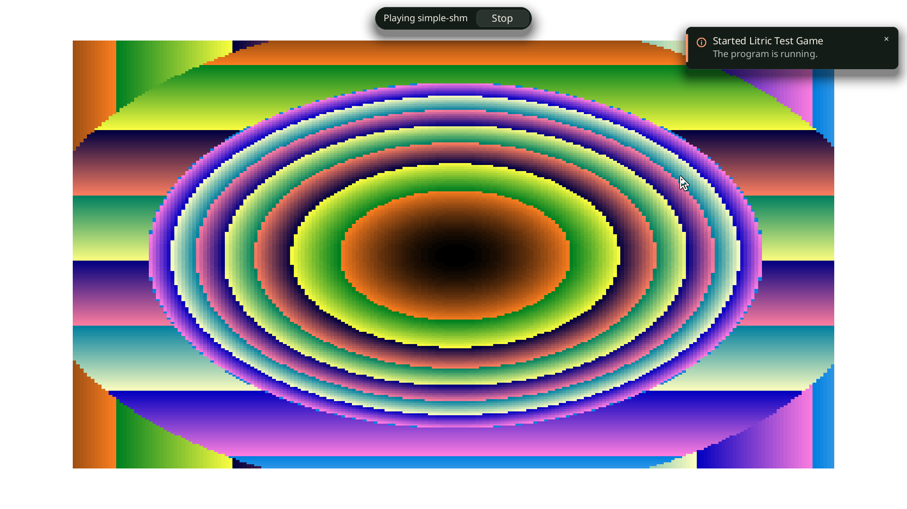
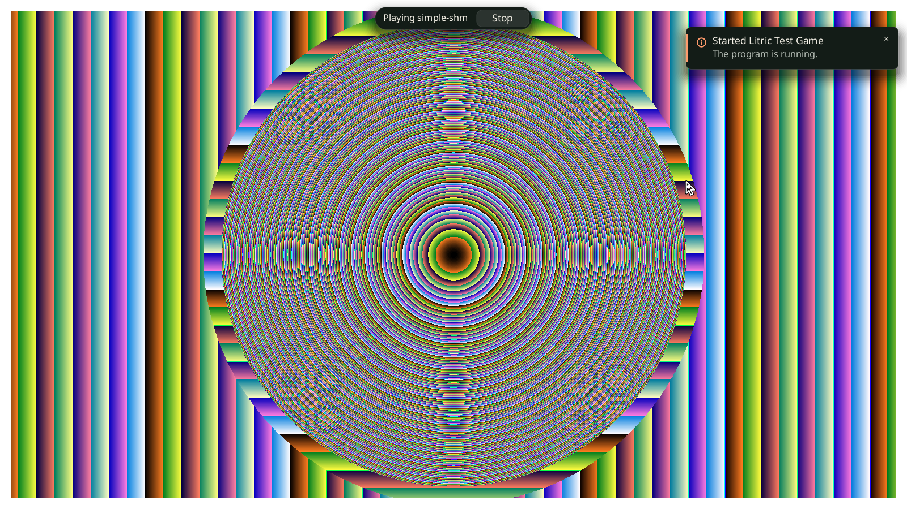
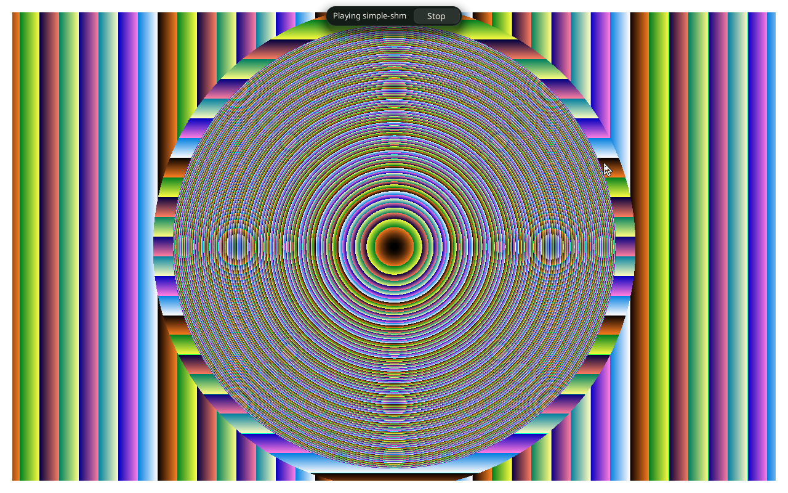
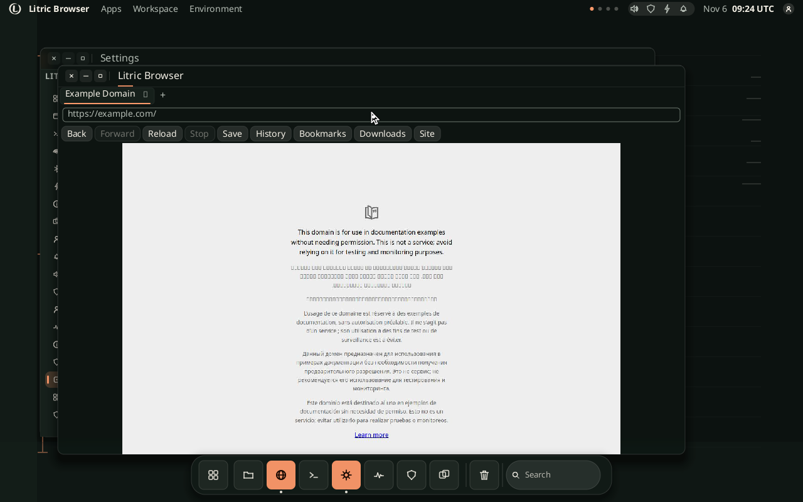
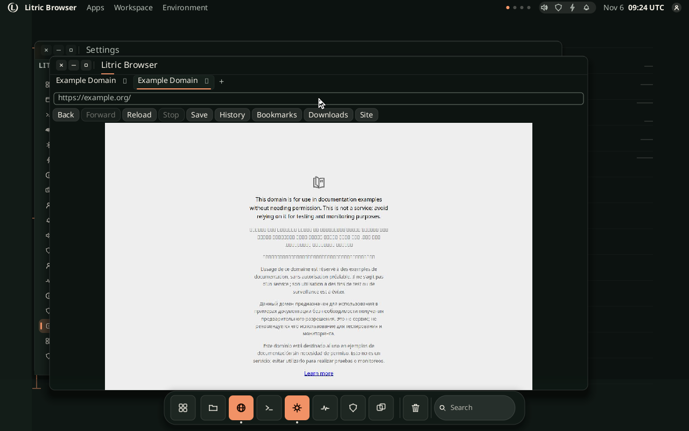
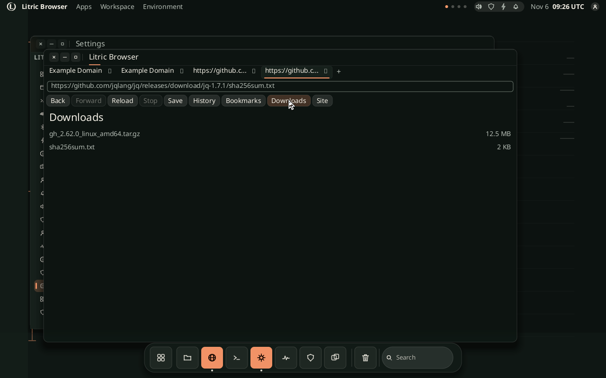

# QEMU guest proof: boot, install, compatibility launch, network and Stop

**Result: PASS_WITH_LIMITATIONS (2026-11-06).** The same boot also loads two
external HTTPS pages in the browser's Chromium engine and imports two real
downloads (2,129 and 13,065,800 bytes) through the browser's Downloads panel;
see
[Browser end to end](#browser-end-to-end-a-real-engine-in-the-booted-guest).
The 2026-11-06 KMS extension presented the shell through DRM/KMS on QEMU's
virtual `bochs-drm` card (`present=drm`, `drm.mode=1280x800`,
`drm.connector=Virtual-1`, `LITRIC_DRM_FLIP=ok`). The browser correctly stayed
on its software path because this virtual card has no render node. This is a
booted Linux guest,
not a composition in the host process. It is a **direct-kernel initramfs boot**
under QEMU TCG, not the repository's mkosi disk image or a UKI. The original
clean bootstrap run at 1280x800 started with no `/tmp/litric-*` trees and no
`build/qemu-bootstrap`; this session reused that completed cache for three
successful display boots (**1280x800, 1600x900 and 1920x1080**) and a fourth
compatibility/network boot at 1280x800. The display mode is chosen when QEMU
boots; no in-guest mode switch or hotplug was performed.

## What ran

| Stage | Observed evidence |
|---|---|
| Bootstrap | `tools/qemu-guest-bootstrap.sh`, called by `tools/qemu-guest-proof.sh`; a rootless private APT download of about 220 MB produced QEMU 8.2.2, SeaBIOS/data, cpio, zstd, the Ubuntu 24.04 kernel and modules, and a minimal guest rootfs |
| Bootable image | `artifacts/qemu-guest-proof/litricos-qemu-initramfs.cpio.gz` (6.5 MiB), built from the release `litric-sysd`/`litric-shell`, the bootstrapped Ubuntu userspace, and the repository's `weston-simple-shm` fixture |
| Kernel and emulation | Ubuntu `vmlinuz-6.8.0-147-generic`; QEMU `q35,accel=tcg`, 2 vCPU, 2048 MiB, `-nic user,model=e1000`, and an explicit `VGA,edid=on,xres=W,yres=H,vgamem_mb=16` device |
| Guest shell | The guest's own `/sys/class/graphics/fb0/virtual_size` reported `1280,800`, `1600,900` and `1920,1080` for the three boots; the shell independently logged `litric.shell.canvas` and `litric.shell.fb` at the same sizes, with `litric.shell.scale=1.00`, `1.25` and `1.50` |
| Installer | `litric-sysd --query 'APP INSTALL com.litric.test-game game'` answered `OK 2`, `id=com.litric.test-game`, `state=installed`; the installed files are listed by the guest's own init |
| Client | QMP clicked Play; the guest reported a fullscreen `litric.client "simple-shm"` at exactly the booted framebuffer size in every run |
| Pixels | QMP `screendump` read the guest scanout; the 1920x1080 game frame had 1,118,252 colourful and 561,253 bright pixels |
| Stop | QMP clicked Stop; the client window disappeared and the stopped frame contained only the desktop and Settings |
| Compatibility launch | The guest's Play click used the shell → `litric-sysd` `LAUNCHENV` path, which now resolves the native Linux profile in `litric-sysd/src/compat.rs` before the real `execve`; `result.json` contains the resulting `litric.client` frame |
| Guest network | QEMU user-mode networking with the `e1000` driver; the guest configured `10.0.2.15/24`, fetched `http://10.0.2.2:18080/proof.txt` from a host HTTP server, and logged `LITRIC_NETWORK_OK` plus `litric-network-proof` |
| Driver assertions | `result.json`: `guest_network`, `installed`, `colourful_above_floor`, `client_window_gone_after_stop`, `colourful_below_ceiling_after_stop` — all `true` in the compatibility/network run |

### Captured display matrix

Every value below was read from the guest or from the hypervisor's scanout
capture; none is a predicted layout value.

| Guest mode | Guest framebuffer readback | Settings window | Fullscreen client | Screenshot | Colourful / bright pixels |
|---|---|---|---|---|---|
| 1280x800 | `LITRIC_FB: 1280,800`; `litric.shell.fb=1280x800 32bpp stride=5120` | `980x620+64+76` | `#2 litric.client "simple-shm" 1280x800+0+0 fullscreen` | 1280x800 | 691,056 / 102,202 |
| 1600x900 | `LITRIC_FB: 1600,900`; `litric.shell.fb=1600x900 32bpp stride=6400` | `1225x775+64+83` | `#2 litric.client "simple-shm" 1600x900+0+0 fullscreen` | 1600x900 | 959,201 / 130,224 |
| 1920x1080 | `LITRIC_FB: 1920,1080`; `litric.shell.fb=1920x1080 32bpp stride=7680` | `1470x930+64+90` | `#2 litric.client "simple-shm" 1920x1080+0+0 fullscreen` | 1920x1080 | 1,118,252 / 561,253 |

For all three modes:

* the shell-reported window count went from **2 to 1** after Stop (the client
  disappeared, leaving Settings);
* every shell window frame was inside the framebuffer (`windows_inside_framebuffer`);
* the Settings frame was exactly the base `980x620` scaled by
  `width / 1280` (`settings_window_scaled`);
* the game and stopped screenshots had exactly the framebuffer dimensions
  (`game_screenshot_at_expected_size`, `stopped_screenshot_at_expected_size`);
* the client window line was exactly `WxH+0+0 fullscreen`
  (`client_fullscreen_at_expected_size`);
* the framebuffer status line named the same width and height
  (`geometry_checks.framebuffer`).

The stopped frames contained 4,816 (1280x800), 7,455 (1600x900) and 10,649
(1920x1080) colourful pixels, with one remaining Settings window in each run.
The QMP Play click was derived from the captured Settings frame, not from a
fixed 1280x800 coordinate; the resulting centres were `(981,266)`,
`(1210,321)` and `(1440,375)` for the three modes. Stop centres were
`(713,26)`, `(891,32)` and `(1070,39)`.

The cache-hit display runs took **33s** (1280x800), **34s** (1600x900) and
**38s** (1920x1080) wall time. The earlier clean bootstrap at 1280x800 took
**62s**; these runs did not repeat that download. The compatibility/network
regression at 1280x800 passed with `game.png` at 1280x800, 675,342 colourful
and 100,737 bright pixels, `stopped.png` at 1280x800, and windows 2 → 1.
`cargo test --workspace` exited 0 with 2,091 passing tests and 0 failures in
the earlier display run; the compatibility/network run is checked by the
focused `litric-sysd` tests recorded below and by the final workspace run in
[`GATES.md`](GATES.md).

### KMS output and GPU discovery (2026-11-06)

QEMU still uses its `VGA` device (`VGA,edid=on,xres=1280,yres=800`): this QEMU
build has no `virtio-gpu-pci`. The guest loaded `bochs-drm`, and the shell chose
the DRM presenter instead of fbdev. The status file and the helper's own line
are:

```text
litric.shell.present=drm
litric.shell.drm.card=/dev/dri/card0
litric.shell.drm.mode=1280x800
litric.shell.drm.connector=Virtual-1
litric.shell.gpu=card=/dev/dri/card0 driver=bochs-drm vendor=0x1234 device=0x1111 render=none
LITRIC_DRM_FLIP=ok
```

Two consecutive boots (`gpu-1280x800-run2` and `gpu-1280x800-run3`) each record
all **38 assertions true**, including `gpu_present_drm`, `gpu_card_node`,
`gpu_driver_named`, `gpu_kms_mode`, `gpu_kms_connector` and `gpu_pageflip`; all
eight geometry checks are true in both runs. The virtual card is a 2D
display controller, not a 3D GPU: `gpu.render=none`. The browser's own log says
`browserd: gpu=software(no render node under /dev/dri)`, so this run does not
claim GPU rasterisation or hardware video decode.

The browser also has a conditional hardware path now. When a
`/dev/dri/renderD*` node exists, `browserd` enables Chromium GPU
raster/compositing (Vulkan when an ICD is installed, system EGL otherwise);
without a render node it passes `--disable-gpu`. The image unit exposes only
`char-drm` to the broker (`PrivateDevices=no`, `DevicePolicy=closed`,
`DeviceAllow=char-drm rw`). That hardware branch is unit-tested here but was not
reachable in this virtual guest.

The screenshots are reads of the guest framebuffer, not a host-side render:







Machine-readable results, serial transcripts and captures:

* 1280x800 compatibility/network run:
  [`result.json`](../artifacts/qemu-guest-proof/compat-network-1280x800/result.json),
  [`serial.log`](../artifacts/qemu-guest-proof/compat-network-1280x800/serial.log),
  [`game.png`](../artifacts/qemu-guest-proof/compat-network-1280x800/game.png)
* 1280x800: [`result.json`](../artifacts/qemu-guest-proof/result.json),
  [`serial.log`](../artifacts/qemu-guest-proof/serial.log),
  [`game.png`](../artifacts/qemu-guest-proof/game.png)
* 1600x900: [`result.json`](../artifacts/qemu-guest-proof/1600x900/result.json),
  [`serial.log`](../artifacts/qemu-guest-proof/1600x900/serial.log),
  [`game.png`](../artifacts/qemu-guest-proof/1600x900/game.png)
* 1920x1080: [`result.json`](../artifacts/qemu-guest-proof/1920x1080/result.json),
  [`serial.log`](../artifacts/qemu-guest-proof/1920x1080/serial.log),
  [`game.png`](../artifacts/qemu-guest-proof/1920x1080/game.png)

## Reproduce it

On an x86_64 Ubuntu/Debian host, from the repository root:

```sh
export PATH="$HOME/.cargo/bin:$PATH"
./tools/qemu-guest-proof.sh
```

Run a different boot mode by setting the guest geometry and a separate output
directory:

```sh
LITRIC_QEMU_WIDTH=1600 LITRIC_QEMU_HEIGHT=900 \
LITRIC_QEMU_OUT=artifacts/qemu-guest-proof/1600x900 \
    ./tools/qemu-guest-proof.sh

LITRIC_QEMU_WIDTH=1920 LITRIC_QEMU_HEIGHT=1080 \
LITRIC_QEMU_OUT=artifacts/qemu-guest-proof/1920x1080 \
    ./tools/qemu-guest-proof.sh
```

The width and height default to `1280x800` and are restricted to the shell's
supported `320x200..2560x1600` range. The script passes the same dimensions to
QEMU's VGA device and to the QMP driver; it does not post-process a 1280x800
capture into another size.

Host prerequisites are `bash`, `apt-get`, `apt-cache`, `dpkg-deb`, `find`,
`sort`, `awk`, `sha256sum`, Rust/Cargo and Python 3. The proof downloads its
QEMU, kernel and guest userspace; none of them need to be installed on the
host. It uses no root and never writes the host's package database.

On the first run, `tools/qemu-guest-bootstrap.sh` creates
`build/qemu-bootstrap/` and:

* copies the host's `/etc/apt/sources.list*` into a private APT root;
* downloads about 220 MB from the Ubuntu archive and security sources (this
  run used `archive.ubuntu.com` and `security.ubuntu.com` over HTTP port 80);
* extracts QEMU 8.2.2, SeaBIOS/QEMU data, `cpio`, `zstd`, Ubuntu
  `linux-image-6.8.0-147-generic` plus modules and extras, `busybox-static`,
  `libc6`, `libgcc-s1`, `libffi8` and `fonts-noto-core`;
* builds a minimal rootfs with BusyBox applets, glibc, the DRM/input modules,
  the `e1000` NIC driver, and Noto fonts;
* writes `kernel-release` and `.complete` markers only after the cache is
  usable.

The measured cache is 517 MiB of APT data, 359 MiB of tools and 8 MiB of
rootfs (about 884 MiB). Allow roughly 1 GiB free for the first run. The clean
proof including that bootstrap took 62s; package fetch was 12s of it. Timings
vary with the network and host.

### Cache and offline runs

A completed cache short-circuits bootstrap without touching the network:
`build/qemu-bootstrap/.complete` plus the required files make
`qemu-guest-bootstrap.sh` print `using complete cache`. A test with HTTP and
HTTPS proxies pointed at a closed port still exited 0 from that cache. To put
the cache elsewhere:

```sh
export LITRIC_BOOTSTRAP_CACHE=/path/to/qemu-bootstrap
./tools/qemu-guest-proof.sh
```

To force a fresh download, remove `build/qemu-bootstrap` and rerun. A partial
APT cache is reused; a cache with `.download-complete` but no kernel marker is
rejected rather than booted.

To use a prepared toolchain and rootfs instead of the download:

```sh
export LITRIC_TOOLS=/path/to/tools
export LITRIC_ROOTFS=/path/to/rootfs
./tools/qemu-guest-proof.sh
```

Both variables must be set together; setting only one is an error. The tools
tree must contain `usr/bin/qemu-system-x86_64`, `usr/bin/cpio`, an Ubuntu
`boot/vmlinuz-*`, matching `lib/modules`, QEMU modules and BIOS data. The rootfs
must contain a static BusyBox with applet links, glibc, the bochs DRM,
`virtio_input` and `e1000` modules, fonts, and `/usr/bin/litric-fbpresent`. The script builds
the release binaries, stages a fresh guest rootfs, writes `init`, packs the
initramfs, boots QEMU with no display, and runs the QMP driver.

If the first download cannot reach the archive, the bootstrap exits non-zero
and names the network endpoints plus the `LITRIC_TOOLS`/`LITRIC_ROOTFS`
alternative (tested by pointing `http_proxy` and `https_proxy` at
`127.0.0.1:9`). It does not create `.complete`, so a later rerun retries. The
proof also fails before boot if only one custom tree is supplied.

A TCG boot can outlive a host command wrapper's limit. To capture the script's
own status on such a host, detach it and wait for its status file:

```sh
rm -f /tmp/qemu-proof.exit
nohup bash -c 'export PATH="$HOME/.cargo/bin:$PATH"; \
  ./tools/qemu-guest-proof.sh; echo $? >/tmp/qemu-proof.exit' \
  >/tmp/qemu-proof.log 2>&1 &
# inspect progress and, when it finishes:
tail -n 80 /tmp/qemu-proof.log
cat /tmp/qemu-proof.exit   # 0 means PASS
```

Outputs are written below `artifacts/qemu-guest-proof/`; `result.json` is
written only after all assertions pass. The driver now takes `--width` and
`--height`, asserts the resolution read back from the guest framebuffer, asserts
the fullscreen client's exact frame, asserts the Settings frame is the scaled
base geometry and that all frames are inside the screen, and asserts the
screenshot dimensions. It also reads the newest `litric.shell.window=` state,
so an older marked status block or a pre-Stop `window=#2` line is not mistaken
for the current client.

## What failed at 1920x1080, and what was fixed

The first 1920x1080 run booted the shell and mapped Settings, but the driver
failed with `the status has no Settings window geometry`: it searched only the
last marked `LITRIC_STATUS_BEGIN/END` block, while the shell's window
diagnostics were outside that block in the serial stream. It also used a fixed
1280x800 absolute Play coordinate. At 1920 the Settings window is at
`1470x930+64+90`; scaling the old absolute point did not land on Play.

The fix was in the proof harness, not in the shell's fullscreen resize path:

* the driver's `latest_window_text()` reads from the newest
  `litric.shell.windows=` line onward, and all window checks use it;
* `play_point()` adds the offset from the base Settings origin to the *captured*
  Settings frame, so the click follows the window manager's actual placement;
* `--width`/`--height` flow from the script into the QMP coordinate mapping and
  every expected geometry;
* the new checks require the guest framebuffer, Settings scale, client frame,
  screenshot dimensions and window counts to agree.

No change to `src/litric-shell/src/clients.rs` was required for this task: at
1280x800, 1600x900 and 1920x1080 the guest reported the fullscreen client at
exactly the framebuffer size with origin `+0+0`, and all frame-inside checks
passed. That is evidence for these three boot modes, not proof that every
possible size or a runtime resize is correct.

## The defect that made the client invisible

The first initramfs had no `/dev/shm`. `weston-simple-shm` could connect and map
its window, but could not allocate a shared-memory buffer, so the shell had no
client pixels to compose. The serial console showed a mapped window while the
scanout still contained the shell's fallback content. Mounting a tmpfs on
`/dev/shm` in the guest init before starting the shell fixed the cause; the
proof now asserts the client's pixels, not merely that a window exists.

The inner init also mounts `proc`, `sysfs` and `devtmpfs`, loads `ttm`,
`drm_ttm_helper`, `drm_vram_helper`, `bochs` and `virtio_input`, and seeds
`onboarded=1` so the proof starts on the desktop rather than the first-run flow.
The game is installed through the real `litric-sysd` socket, not by copying a
desktop file and calling a private shell function.

## Browser end to end: a real engine, in the booted guest

Two things kept the browser off every image, and both are fixed:

* `litric-browserd` was gated behind `required-features = ["broker"]`, so no
  default build contained it. `broker` is now a default feature: the binary is
  produced by `cargo build -p litric-browser` and by `cargo build --workspace`,
  and the proof builds it with the other product binaries.
* the guest rootfs had no engine. `tools/qemu-guest-bootstrap.sh` now downloads
  Chrome for Testing 131.0.6778.204 (sha256
  `fba7d5e87cdcf0dc974c9ac8a0a9dbcf5686c935455d5e6beed337c6ada88bc2`), stages
  it at `/opt/chrome`, and adds its shared-library closure from the Ubuntu
  archive plus `/etc/fonts`. A cache schema marker refreshes an older cache
  instead of taking it for a complete one. `LITRIC_CHROME_ZIP` builds the image
  offline from a local archive; the version and hash stay pinned.

The broker runs as the unprivileged `litric` user (uid 1000) because Chromium
refuses its sandbox as root, exactly as the image's unit does. Its socket lives
in `/run/litric-browser/browser.sock` — the unit's `RuntimeDirectory` — because
`/run/litric` is root-owned and a broker that cannot write there is a broker
that exits with EACCES. The engine starts on the first real navigation; the
start page is the shell's own surface. The guest writes `nameserver 10.0.2.3`,
QEMU user-mode networking's DNS forwarder.

QMP drives the same UI a person uses: `Meta` opens the launcher, "browser"
launches the app, and the driver clicks the address field at the exact hotspot
the shell paints (`browser.omnibox_click=592,183`); the shell's
`browser.omnibox=` diagnostic says when the field took focus. The driver then
types `example.com` and presses Enter. The omnibox's normalisation turns that
into `https://example.com/`; the harness never hands a URL to a private path.

The proof creates four tabs: two page tabs (`example.com`, `example.org`) and
two download tabs. It does not navigate a page tab to a download URL: Chromium
has no document for a response it turned into a download, so a reused download
tab would be an error document rather than normal tab handling. Each download
tab is opened with Ctrl+T, its URL is typed into the same omnibox, and the
Downloads panel is opened by clicking the shell's own
`browser.downloads_click=610,213` hotspot rather than a guessed coordinate.

`result.json` records every one of these as `true` in the same run as the game
proof:

| assertion | evidence |
|---|---|
| `browser_window`, `browser_window_inside_framebuffer` | `window=#3 com.litric.browser "Litric Browser" 1000x620+92+104` |
| `browser_engine_chromium` | `browserd: engine = chromium (/opt/chrome/chrome)` |
| `browser_gpu_software_fallback` | `browserd: gpu=software(no render node under /dev/dri)`; the guest's render field is `none` |
| `browser_https_url`, `browser_title` | `browser.tab=https://example.com/`, `browser.title=Example Domain` |
| `browser_frame_received`, `browser_viewport` | `browser.frame=4096000 bytes`, `browser.viewport=1280x800` |
| `browser_pixels` | more than 380,000 bright pixels in the scanout |
| `browser_two_tabs`, `browser_second_tab_loaded` | page tabs `https://example.com/` and `https://example.org/`, both titled `Example Domain` |
| `browser_download_active`, `browser_download_large` | a `.crdownload` of at least 1,000,000 bytes existed before the second request; the large file is 13,065,800 bytes |
| `browser_download_staged`, `browser_download_saved` | both files staged and saved with the expected size and sha256: 13,065,800 bytes and 2,129 bytes |
| `browser_downloads_concurrent`, `browser_download_listed` | both transfers overlap, both are imported, and the panel reports `browser.downloads=2` |
| `browser_download_tabs_closed` | Ctrl+W twice: `4 active=3` → `3 active=2` → `2 active=1` |
| `browser_tab_closed` | after close, active `https://example.org/` is loaded with a 4,096,000-byte frame |
| `browser_tab_switch_back`, `browser_tab_switch_after_close` | Ctrl+1 → `2 active=0` `https://example.com/`; Ctrl+2 → `2 active=1` `https://example.org/`; both loaded |
| `browser_tab_cycle_after_close` | Ctrl+Tab → `2 active=0` `https://example.com/`, loaded |
| `browser_final_status_loaded` | final status is `loaded — Example Domain` at 1280x800 |
| screenshots | `browser-downloads.png`, `browser-tabs-closed.png` and `browser-tabs-switched.png` are each 1280x800 |



For the second page tab the driver sends Ctrl+T, focuses the same address field,
types `example.org` and presses Enter; the shell reports `browser.tabs=2
active=1`, both page tabs have their own `Example Domain` render, and Ctrl+1
returns to the first page tab with `https://example.com/` still loaded.



The downloads are real public assets, not fixtures served by the harness:

* `https://github.com/cli/cli/releases/download/v2.62.0/gh_2.62.0_linux_amd64.tar.gz`
  is 13,065,800 bytes with sha256
  `41c8b0698ad3003cb5c44bde672a1ffd5f818595abd80162fbf8cc999418446a`.
* `https://github.com/jqlang/jq/releases/download/jq-1.7.1/sha256sum.txt`
  is 2,129 bytes with sha256
  `f1f692fe9f923a4f5c6741729fb5931212ebccfff976225feb7a2ccec8635da4`.

Chromium answers each navigation with a download instead of a document, which
the broker reports as `net::ERR_ABORTED`; that is the browser doing what a
browser does, and the broker stages each file in
`/run/litric-browser/Downloads`. The driver starts the large request first and
waits until the broker reports an in-flight `.crdownload` of at least 1,000,000
bytes, then starts the small request. That overlap is
`browser_download_active`, `browser_download_large` and
`browser_downloads_concurrent`; it is an overlap check, not a throughput claim.
The guest's `litric-filesd` imports both files into `/Downloads`, the driver
clicks the shell's `browser.downloads_click` hotspot, reads
`browser.downloads=2`, and hashes each saved file from its on-disk path. Both
have the expected size and sha256, so the transfer completed rather than
leaving a placeholder.



After both imports, Ctrl+W closes the small-download tab and then the
large-download tab: `4 active=3` → `3 active=2` → `2 active=1`. The active
remaining tab is `https://example.org/`, still `loaded — Example Domain` with a
4,096,000-byte frame. Ctrl+1 then selects `https://example.com/` (`2 active=0`),
Ctrl+2 selects `https://example.org/` (`2 active=1`), and Ctrl+Tab cycles back
to `https://example.com/`; every switch is checked for the URL, loaded status
and a live frame.


All five images are QMP `screendump`s of the guest's scanout, not host renders.

The proof also found a real broker defect: after a page tab had been in the
background while downloads completed, `ACTIVATE` could leave
`Page.captureScreenshot` without a reply for 60 seconds. `refresh_frame` now
issues `Page.bringToFront` before it reads or captures the target; without that,
the switch assertions time out instead of passing on stale pixels. The
`tabs_after_switch_*` assertions require a fresh frame, so this regression
would fail the proof.

`browser.png`, `browser-tabs.png`, `browser-downloads.png`,
`browser-tabs-closed.png` and `browser-tabs-switched.png` are accompanied by
`result.json`, `result-run1.json`, `result-run2.json`, the serial transcript and
the engine's own log below `artifacts/qemu-guest-proof/browser-1280x800/`.

### What this does not establish

* Four tabs at one size, under TCG. The shell's scanout is virtual KMS
  (`bochs-drm`); the browser logged `gpu=software(no render node under
  /dev/dri)` and ran with `--disable-gpu`. No hardware 3D GPU, video, audio,
  DBus service, camera or microphone was exercised.
* The engine is Chrome for Testing, pinned for this proof. The mkosi desktop
  profile still declares the distribution's `chromium` and is a separate build.
* The browser loads HTTPS only: the broker refuses `http://`, so no plaintext
  page was tested.
* Two public transfers were exercised: a 13,065,800-byte tarball and a
  2,129-byte text file. Ranged or resumed transfers, other MIME types, and a
  persistent profile were not tested; `/run/litric-browser` is ephemeral in the
  guest, as it is on the image.
* Ctrl+W closed the two download tabs; closing a tab that held a live page was
  not exercised. Many tabs, reorder, popups, history, session restore and
  per-tab download ownership beyond these two files were not tested.
* No Steam, Flatpak, Proton or Roblox work is part of this change.

## Limits

* **No runtime mode switch or hotplug.** Each size was selected at boot with
  QEMU's explicit VGA `xres`/`yres`. The proof covers three boot modes, not an
  in-session mode change, monitor hotplug, or every aspect ratio/resolution.
  4K, fractional scaling, and display rotation were not tested.
* **No KVM.** `/dev/kvm` is not usable by this account, so all of this ran
  under TCG software emulation. No boot-time or frame-time number from this run
  is a hardware performance claim.
* **Not the mkosi image.** This proves a bootable initramfs with a direct
  kernel. It does not prove the mkosi disk layout, UKI, dm-verity, systemd
  units, first-boot services or a persistent installed system. The initramfs is
  ephemeral; the installed bundle lives in the guest's RAM for this boot.
* **Virtual KMS only; no physical GPU or 3D.** The shell reports `present=drm`
  with `bochs-drm`, `drm.mode=1280x800`, `drm.connector=Virtual-1` and
  `LITRIC_DRM_FLIP=ok`. The card exposes no render node (`gpu.render=none`), so
  the browser uses its software path. The scanouts are real guest framebuffer
  reads, but they are not a physical display, a 3D rasteriser, VA-API or a
  performance measurement.
* **The game's network check is one host-only probe.** QEMU user-mode
  networking and the `e1000` driver carried one HTTP request to a local proof
  server for the game proof. The separate browser proof reached GitHub over
  HTTPS for both downloads, so DNS and Internet egress are covered there.
  Multiplayer, game networking, full-system network policy and the game's own
  online path were not tested.
* **One deterministic client.** `weston-simple-shm` is a real third-party
  Wayland client, but it is not a playable commercial game. Roblox, real games,
  Steam/Proton, gamescope, anti-cheat, Qt/GTK applications, audio and input
  hotplug were not tested. This is **not** a claim of complete Linux
  compatibility.
* **Bootstrap is host- and archive-specific.** It supports x86_64 Ubuntu/Debian
  hosts with `apt-get` and `dpkg-deb`, and it resolves candidate packages from
  the host's configured Ubuntu archive rather than pinning versions. Other
  distributions, an archive without egress, or a fully offline first run need
  the `LITRIC_TOOLS`/`LITRIC_ROOTFS` path. The first run needs about 220 MB of
  download and 1 GiB of free space; the resulting cache is disposable.
* **No commit/push.** The scripts and this record are working-tree changes. The
  screenshots, serial logs and result JSON are under the ignored `artifacts/`
  tree, so a clone must rerun the proof rather than assume the images are in
  Git.
